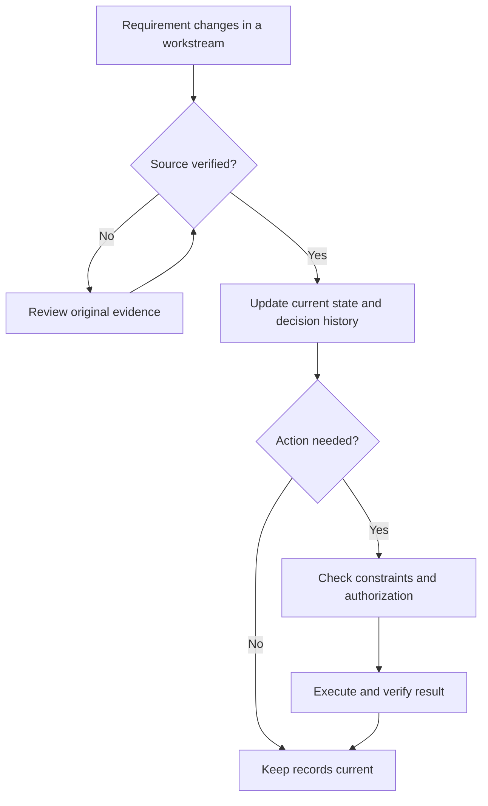

# AI-Assisted Operations & Knowledge Management Framework

**Independent systems-design project · 2026–present**  
**Business systems analysis · Workflow coordination · Information governance · Applied AI**

I designed and iteratively refined an **AI-assisted operations framework** to keep multiple workstreams aligned as requirements, priorities, and commitments change. It brings together project ownership, decision history, scheduling coordination, and checks that distinguish planned actions from verified results.

**The problem:** Across coursework, career development, student leadership, and independent projects, important information lived in separate conversations, documents, and calendars. An updated deadline in one workspace could leave another plan relying on an older version. I wanted a system that could trace the change, identify the next action, and preserve what had already been decided.

## What I designed

| Component | Role in the system |
|---|---|
| **Workstream ownership** | Each project maintains its requirements, decisions, and progress. |
| **Three-layer knowledge structure** | Current state (**HOT**), decision history (**WARM**), and original evidence (**COLD**) serve different retrieval needs. |
| **Source and change controls** | New information is checked against its source; replaced decisions remain traceable. |
| **Scheduling handoffs** | Verified changes are considered alongside available time and protected commitments. |
| **Execution checks** | Proposed, authorized, scheduled, completed, and verified work are tracked separately. |

## How it works



The operating rules connect ChatGPT workspaces, structured records, and scheduling and file-management tools. Each workstream remains responsible for its own information, while shared procedures guide changes that affect other areas.

[Explore the full architecture](docs/ARCHITECTURE.md).

## Two examples

**A01 — A deadline moves.** In a fictional scenario, a project deadline changes from **November 20 to November 18**. The model selects the verified update, finds work periods around protected commitments, and waits for authorization before recording a simulated change. It never marks the underlying task complete simply because time was scheduled. **10/10 automated tests passed.** [See the workflow](docs/A01_WORKFLOW.md).

**B01 — The wrong task gets resumed.** In a documented continuity incident, historical information had been preserved, but the assistant selected the wrong work to continue. I analyzed the context-selection error and refined the rules for source review and action authority. An accompanying fictional reference model tests those decision rules. **11/11 automated tests passed.** [Read the analysis](docs/B01_FAILURE_AND_RECOVERY.md).

## Explore the project

- [Detailed operating model](docs/ARCHITECTURE.md) · [Project overview](docs/PROJECT_BRIEF.md)
- [Reproduction guide](docs/REPRODUCE.md) · [Evidence and methodology](docs/EVIDENCE_AND_METHODOLOGY.md)

The demonstrations use Python's standard library and fictional fixtures. To run all 21 local tests:

```bash
(cd demos/a01 && python -m unittest discover -s tests -v)
(cd demos/b01 && python -m unittest discover -s tests -v)
```
