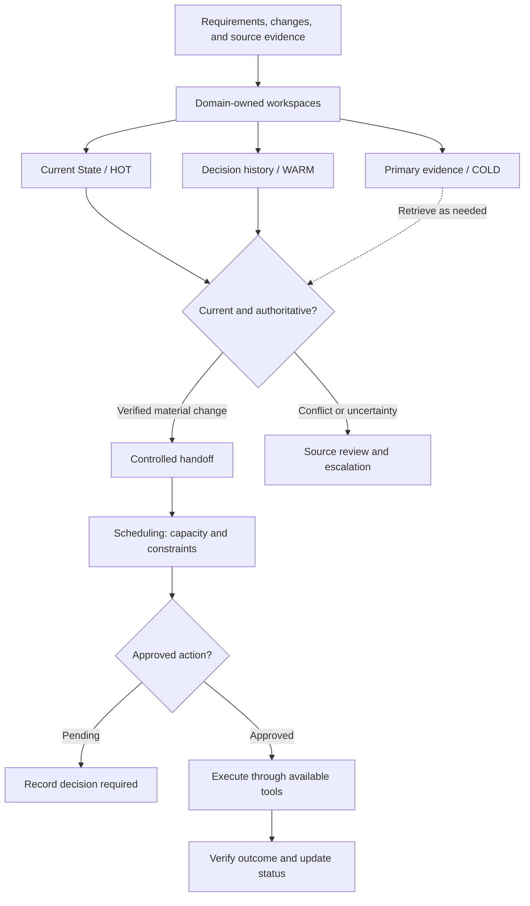

# AI-Assisted Operations & Knowledge Management Framework

**Systems design · Workflow orchestration · Information governance · Quality assurance**  
**Independent systems-design project | 2026–present**

I designed and iteratively refined an **AI-assisted operations and knowledge management framework** to coordinate complex workstreams, preserve decision history, manage changing requirements, and strengthen execution accountability. It supports academic operations, professional development, project management, scheduling, and organizational leadership through shared governance and distinct domain ownership.

**The challenge:** How can independent workstreams stay coordinated as their requirements, priorities, sources, and commitments change—while keeping decisions traceable and execution status accurate?

## Problem and approach

Managing concurrent initiatives across conversations, documents, and calendars created recurring challenges: fragmented context, outdated requirements, competing obligations, unclear handoffs, and difficult-to-verify progress.

I treated these as **systems and operations design problems**. I established a layered information architecture, defined ownership and source-authority rules, connected changes to scheduling decisions, and introduced verification and recovery procedures. I refined the framework through operational use, investigating errors and adjusting its controls as new needs emerged.

## What I designed

| System capability | Design decision | Value delivered |
|---|---|---|
| **Tiered knowledge management** | Separate current operational state, detailed decision history, and original source material | More targeted retrieval with preserved context |
| **Information governance** | Track provenance, supersession, corrections, and authoritative versions | More reliable decisions as requirements change |
| **Domain ownership** | Each workstream maintains its own requirements, state, and supporting evidence | Clear accountability and controlled cross-workspace changes |
| **Operational handoffs** | Route relevant demand updates to a dedicated scheduler | Coordinate capacity, priorities, and protected commitments |
| **Execution accountability** | Track requests, approvals, scheduling, execution, and verification distinctly | More meaningful progress reporting |
| **Quality assurance and recovery** | Use source checks, change verification, targeted audits, and failure remediation | Stronger error detection and process improvement |

## Architecture



The framework combines structured operating records, ChatGPT workspaces, and file-management and scheduling tools. Its design coordinates distinct workstreams through shared information and decision controls while respecting each area's ownership and the user's authorization.

[Explore the architecture and operating model](docs/ARCHITECTURE.md)

## Case studies

### A01 · Coordinating a changing deadline

A deadline changes while existing commitments must remain protected. A reproducible scenario demonstrates source-authority checks, scheduling decisions, authorization, and status verification.

**Demonstration:** A fictional project scenario with an executable Python reference model. **10 automated tests passed** across approval, priority, protected-commitment, capacity, and simulated-write conditions.

[Explore A01](docs/A01_WORKFLOW.md)

### B01 · Diagnosing a continuity failure

After a long-running conversation was preserved and recovered, the assistant selected the wrong task to resume. I traced the incident to context selection and premature action inference, then refined rules for interpreting historical stopping points and checking action authority.

**Evidence and demonstration:** A documented historical incident, targeted corrective procedures, and a reproducible Python reference model with **11 passing automated checks**.

[Explore B01](docs/B01_FAILURE_AND_RECOVERY.md)

## Skills demonstrated

**Business systems analysis:** requirements, process mapping, interfaces, ownership, and exception handling.  
**Information governance:** provenance, version control, state management, and historical continuity.  
**Operational planning:** dependency management, capacity evaluation, and cross-workspace coordination.  
**Quality improvement:** root-cause analysis, test design, corrective controls, and verification.  
**Applied AI:** designing workflows that combine AI-enabled capabilities with clear operational rules and accountability.

## Tools and examples

**Framework:** ChatGPT workspaces, structured text documentation, file-management capabilities, and scheduling tools.  
**Reproducible examples:** Python 3 standard-library reference models with fictional fixtures and automated tests. These examples make selected design rules inspectable; historical operational cases are documented separately.

Run the examples:

```bash
(cd demos/a01 && python -m unittest discover -s tests -v)
(cd demos/b01 && python -m unittest discover -s tests -v)
```

## Explore

[Architecture](docs/ARCHITECTURE.md) · [Deadline workflow](docs/A01_WORKFLOW.md) · [Continuity incident](docs/B01_FAILURE_AND_RECOVERY.md) · [Reproduction guide](docs/REPRODUCE.md) · [Evidence and methodology](docs/EVIDENCE_AND_METHODOLOGY.md) · [Project overview](docs/PROJECT_BRIEF.md)
