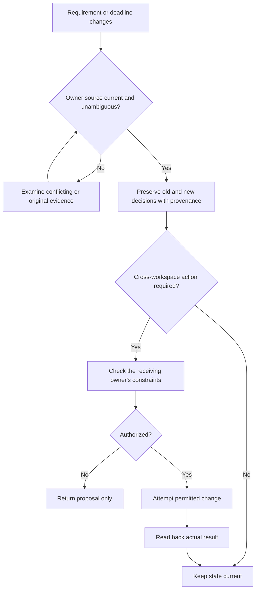

# Architecture | An operations problem with explicit owners

The framework coordinates information and action across independently owned projects. It is **not** a new task-management website or a single program that automatically updates every workspace.

## The real operating structure

| Layer | Content | Purpose |
|---|---|---|
| **HOT — current state** | Active work, latest decisions, unresolved questions, next action | Fast and accurate everyday continuation |
| **WARM — history and rationale** | Decision changes, corrections, source map, superseded versions | Explain why the current instruction is authoritative |
| **COLD — original evidence** | Original records, exports, archived conversations and supporting documents | Resolve serious disputes and verify provenance |

The ownership rule is equally important: a project controls its own requirements; the continuity framework defines how to preserve and retrieve context; the scheduling owner considers authorized work against real time constraints. An updated source is **not** an instruction to change another owner's calendar or mark a task complete.

## From changed requirement to checked result

A practical example is a deadline that changes from November 20 to November 18. The fictional [A01 model](A01_WORKFLOW.md) first establishes which owner's revision is authoritative, then proposes time around existing commitments. It waits for authorization; after an in-memory simulated write, it checks the stored blocks rather than merely asserting that a write occurred. **Scheduling work does not finish the project task.**

The real [B01 incident](B01_FAILURE_AND_RECOVERY.md) illustrates a different risk: complete records can still produce the wrong next step when the assistant interprets the user's historical reference incorrectly. The correction strengthened **which conversation point to select** and **which actions that selection actually permits**.

## Human design and AI assistance

I defined the problem, information structure, owner boundaries, change controls, decision-state distinctions, and recovery requirements; AI assistance helped implement and document selected parts. The repository's two small Python examples expose those design choices to inspection. They do not replace the actual records or independently test live ChatGPT behavior.

[Evidence and selected real-record excerpts](EVIDENCE_AND_METHODOLOGY.md) · [Project README](../README.md)
