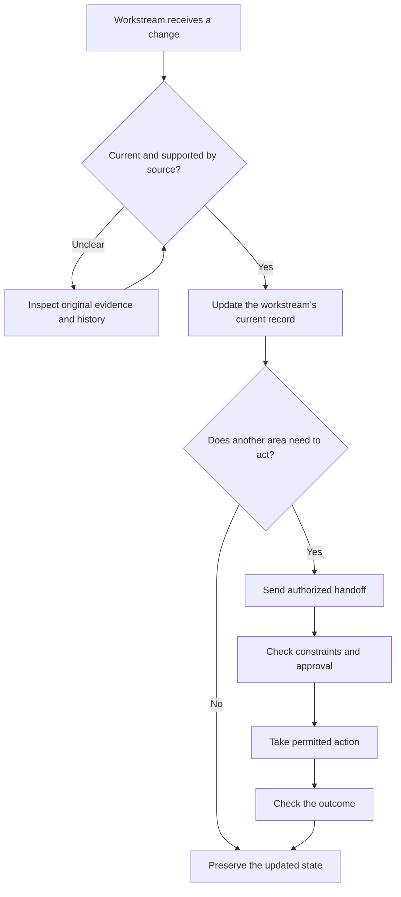

# Architecture and operating model

## The design problem

Changes arrived in separate workspaces, while scheduling and other decisions depended on the latest information from those spaces. I designed the framework to answer four practical questions:

1. **What is the current requirement?**
2. **Which source and decision history support it?**
3. **Who owns the information, and what other work is affected?**
4. **What action is authorized, and how will its result be checked?**

The system brings those questions into a repeatable process.

## Three layers of information

| Layer | What belongs here | When it is used |
|---|---|---|
| **HOT — current state** | Active requirements, current decisions, operating rules, and tracked status | Routine planning and execution |
| **WARM — decision history** | Earlier decisions, corrections, source references, and reasons for changes | Resolving ambiguity and understanding how a decision evolved |
| **COLD — original evidence** | Source documents, archived records, and detailed conversation history | Checking conflicts or reconstructing an event |

Keeping these layers distinct makes the latest operational information easier to find without losing the evidence behind it.

## Who owns what

- **Individual workstreams** manage their requirements, decisions, and progress. For example, a project workspace owns the project's deadline.
- **The continuity framework** maintains the information structure, source-priority rules, version history, and recovery procedures.
- **The scheduling workspace** evaluates approved requests against available time, protected commitments, and competing demands.
- **Verification procedures** distinguish the requested action, the action taken, and the confirmed outcome.

Cross-workspace updates follow the owner's current requirement; older records remain available for review.

## From change to verified outcome

### A concrete handoff example

*Illustrative scenario; the executable model is in [A01](A01_WORKFLOW.md).*

A project owner moves a deadline from November 20 to November 18. The project record retains the old deadline as history and identifies the newly verified one as current. The scheduling procedure then evaluates whether project work fits around three protected commitments. Two one-hour periods are available in the synthetic fixture; the proposed change waits for authorization before its simulated commit. The resulting status identifies the schedule update separately from completion of the project task.

This is the distinction the architecture is designed to preserve: **information changes, planning decisions, and finished work have different owners and evidence.**

## Quality improvement

I iteratively refined the operating rules through source reviews, corrections, read-back checks, and analysis of an observed continuity failure. The [B01 case study](B01_FAILURE_AND_RECOVERY.md) shows how a misinterpreted historical stopping point led to more precise context-selection and action-authority procedures.

## Tools and demonstrations

The framework uses ChatGPT workspaces, structured text records, file-management capabilities, and scheduling tools. The repository's Python examples make selected design rules reproducible using fictional inputs. [Run both examples](REPRODUCE.md).
