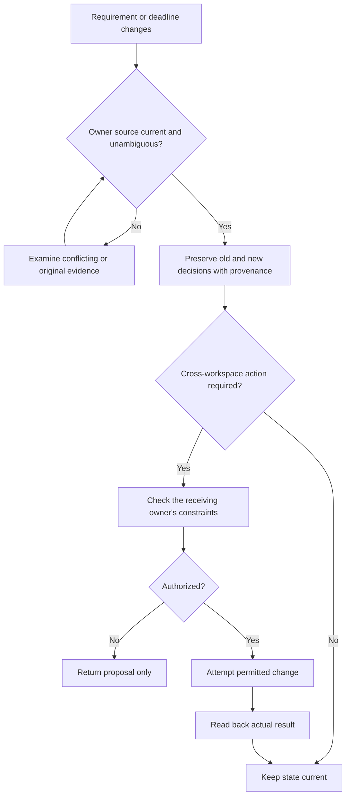

# Architecture | An operations problem with explicit owners

The framework coordinates information and action across independently owned projects through documented source authority, controlled handoffs, and explicit verification.

## The real operating structure

| Layer | Content | Purpose |
|---|---|---|
| **HOT — current state** | Active work, latest decisions, unresolved questions, next action | Fast and accurate everyday continuation |
| **WARM — history and rationale** | Decision changes, corrections, source map, superseded versions | Explain why the current instruction is authoritative |
| **COLD — original evidence** | Original records, exports, archived conversations and supporting documents | Resolve serious disputes and verify provenance |

The ownership rule is equally important: each project controls its requirements; the continuity framework preserves and retrieves context; and the scheduling owner evaluates authorized follow-up against real time constraints. Scheduling and task completion remain separately authorized decisions.

## From changed requirement to checked result

A practical example is a deadline that changes from November 20 to November 18. The fictional [A01 model](A01_WORKFLOW.md) first establishes which owner's revision is authoritative, then proposes time around existing commitments. It waits for authorization; after an in-memory simulated write, it checks the stored blocks rather than merely asserting that a write occurred. **The project task retains its independent completion status until the owner verifies the work.**

The real [B01 incident](B01_FAILURE_AND_RECOVERY.md) illustrates a different risk: complete records can still produce the wrong next step when the assistant interprets the user's historical reference incorrectly. The correction strengthened **which conversation point to select** and **which actions that selection actually permits**.

## Design and implementation

I designed and iteratively refined the information structure, owner boundaries, change controls, decision-state distinctions, and recovery procedures in response to real coordination problems. The framework applies these decisions across workstreams, while the A01 and B01 Python examples make selected controls inspectable and testable.

[Evidence and selected real-record excerpts](EVIDENCE_AND_METHODOLOGY.md) · [Project README](../README.md)
